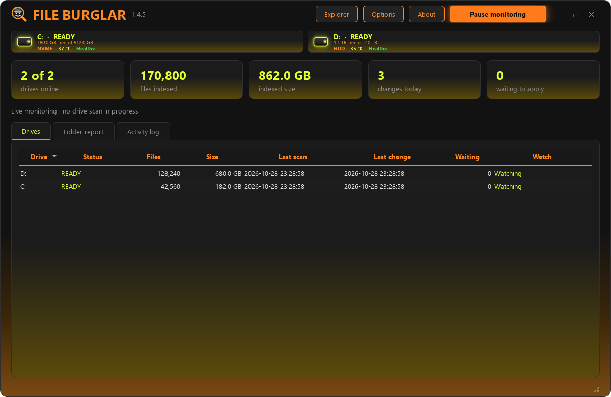
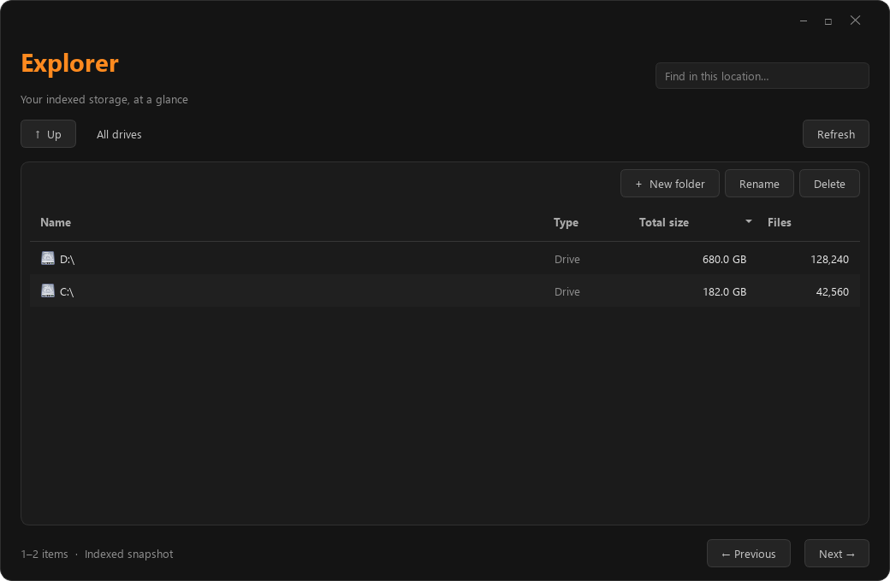
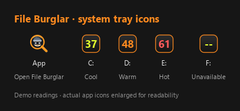
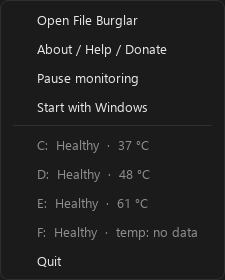

<p align="center"></p>
<h1 align="center">File Burglar</h1>
<p align="center"><strong>Disk-space tracking and drive monitoring for Windows</strong></p>
<p align="center">Live file activity · Indexed Explorer · Drive health and temperatures</p>

File Burglar helps you see where disk space is going. It saves an index of your files and folders, watches for changes, and reports which folders are gaining or freeing space. Drive health and available temperature readings stay accessible from the system tray.

<p align="center">
<a href="https://github.com/snuffy420/FileBurglar/releases/tag/v1.4.5">Download 1.4.5</a> ·
<a href="#features">Features</a> ·
<a href="CHANGELOG.md">Changelog</a>
</p>

**Version 1.4.5** · **Windows 10/11 x64** · **GPL-3.0-or-later** · Created by **snuffy420 / zerØ software**



## Download and install

Get the [Windows release](https://github.com/snuffy420/FileBurglar/releases):

| Package | Use |
| --- | --- |
| [Windows x64 — installer](https://github.com/snuffy420/FileBurglar/releases/download/v1.4.5/FileBurglar-1.4.5-windows-x64-setup.exe) | Complete app, Start menu shortcuts, and an uninstaller. |
| [Windows x64 — portable 7z](https://github.com/snuffy420/FileBurglar/releases/download/v1.4.5/FileBurglar-1.4.5-windows-x64-portable.7z) | Extract the entire folder and run `FileBurglar.exe`. |
| Python source — [7z](https://github.com/snuffy420/FileBurglar/releases/download/v1.4.5/FileBurglar-1.4.5-source.7z) | Application source, assets, tests, and build scripts. |

The installer and portable packages include Python and the required Qt runtime. **You do not need to install Python to use them.** Keep the executable and its `_internal` folder together. macOS, Linux, ARM64-native, and 32-bit builds are not provided in this release.

## Features

- Persistent SQLite file/folder index with file counts, logical sizes, scan dates, and saved drive snapshots.
- Fast, parallel opening scan after every launch, including drives with an existing index. Later rescans run as throttled background work.
- One low-priority worker for new/changed folders, without repeatedly indexing whole drives.
- Windows filesystem notifications for live additions, removals, renames, size changes, and timestamp changes.
- Catch-up reporting for changes since the last completed index, without flooding activity history during a new drive's first baseline.
- A dashboard for drive status, indexed files/size, today's changes, and queued paths.
- Folder reports showing activity, written bytes, freed bytes, and last change, with period and drive filters.
- A searchable activity log with drive/action filters and byte deltas.
- A separate Explorer with breadcrumbs, location search, sortable sizes/counts, cached pages, and 500-item pagination.
- Open indexed files, create folders, rename items, and send selected items to the Windows Recycle Bin. Drive roots are protected from rename/delete.
- Drive identity, bus/media type, Windows health status, and available SMART/reliability counters.
- Available temperatures in individual tray icons, with configurable internal/external warm and hot limits and on-screen temperature alerts.
- ATA SMART temperature fallback for supported SATA-class drives; unsupported readings show as unavailable rather than a false `0 °C`.
- Global pause/resume and per-drive monitoring selection. Hiding a drive's temperature icon does not disable monitoring.
- Opt-in Windows logon startup, using an elevated task for the current user.
- Dark styling with orange accents, a dark-to-orange main-window gradient, and a magnifier/burglar icon at multiple display sizes.
- Local error details, retry controls, and bounded diagnostic logs.



Screenshots use synthetic demonstration data, not a user's private file index.

## System tray

Keep File Burglar in the tray while you work. The main icon opens the app, and optional drive icons show temperatures using your configured cool, warm, and hot colors. Missing readings appear as dashes.



Right-click the main icon to open the window, pause monitoring, configure Windows startup, or quit. Right-click a drive-temperature icon to remove it from the tray; the drive remains monitored.

<table><tr><td></td><td></td></tr></table>

These examples use the app's actual icon artwork and menus with synthetic readings. The icon strip is enlarged for readability; it is not a screenshot of a user's Windows taskbar.

## Getting started

1. Install the setup package, or extract the **entire** portable archive to a writable folder.
2. Open File Burglar and approve its administrator request. Elevated access supports whole-drive monitoring and available storage counters.
3. Let the opening scan finish. It uses parallel, higher-priority workers; the progress line shows the current mode and checked-file count.
4. Use **Folder report** and **Activity log** to investigate changes. Open **Explorer** to browse the indexed snapshot.
5. Close the main window to keep monitoring in the tray. Choose **Quit** from the tray menu to stop the application.

The opening scan intentionally prioritizes speed and can use noticeable CPU/disk bandwidth. After it completes, normal monitoring uses Windows change notifications and background-priority processing. **Pause monitoring** suspends scanning at safe boundaries as well as holding live changes. Selecting **Start with Windows** in the tray creates an opt-in logon task; it does not run an installer or register startup automatically.

After the opening scan, there is **no timer that periodically re-indexes your drives**. Normal file changes update individual records; new directories get targeted, low-priority folder updates. A whole-drive recovery scan is reserved for a real loss of Windows notifications, a drive/feed reconnection, or an explicit retry. The app filters its own database and log notifications before queuing them.

## Data and privacy

| Mode | Index, settings, and diagnostic logs |
| --- | --- |
| Installed executable | `%LOCALAPPDATA%\FileBurglar` |
| Portable executable | `Data` beside `FileBurglar.exe`; keep `portable.txt` beside the executable. |
| Python source checkout | Beside `storage.py`, preserving existing source-checkout data. |

The index stores full file/folder names, sizes, and modification-time keys. It does not copy or hash file contents. Keep the index private. Release packages start with no personal index, settings, or activity logs. Uninstalling the installed app preserves its per-user data; portable data stays in its portable folder.

The app does not upload the index or diagnostics. The optional contact page sends only the fields you submit to your maintainer through Formspree; it does not attach files or logs automatically.

## Limits

- The browser and reports reflect the saved index, not an always-current filesystem view. Use Refresh or allow reconciliation to complete.
- Sizes are logical file sizes, not unique physical allocation. Hard links, sparse files, and compression can make totals differ from Explorer's free-space calculation.
- The app compares size and modification time. A content edit preserving both can escape detection. Changes during a notification overflow or while the app is stopped may be recovered as final state rather than a complete audit of transient files.
- Unreadable folders retain their last known snapshot. Symbolic links and junctions are skipped to avoid traversing linked trees repeatedly.
- SMART counters vary by hardware, USB bridge, driver, and permissions. Some drives will not provide temperature/wear information; ambiguous storage identities are not assigned to an arbitrary disk.
- This release is not a backup, recovery tool, forensic audit, or replacement for drive-manufacturer diagnostics.
- Packages are unsigned. SHA-256 checksums are included; Windows may identify the publisher as unknown.

## Run from source

Install Python 3.12 x64 on Windows, then run:

```powershell
py -3.12 -m pip install -r requirements.txt
py -3.12 main.py
```

`FileBurglar.cmd` also launches the source app without a console. See [building](docs/BUILDING.md) for reproducible packaging steps and [verification](docs/VERIFICATION.md) for what was tested.

## License

Application code and original File Burglar graphics: **GPL-3.0-or-later**. See [LICENSE](LICENSE). Bundled dependencies retain their own licenses; [third-party notices](THIRD_PARTY_NOTICES.md) and license texts are included.

Maintained by [zerØ software / snuffy420](https://github.com/snuffy420).

## Contact

Questions, feedback, or a bug report? Get in touch through the File Burglar contact form, or open a [GitHub issue](https://github.com/snuffy420/FileBurglar/issues). Include your application version, Windows version, and steps to reproduce the problem.

<p align="center">
  <a href="https://snuffy420.github.io/FileBurglar/docs/contact.html">
    
  </a>
</p>
